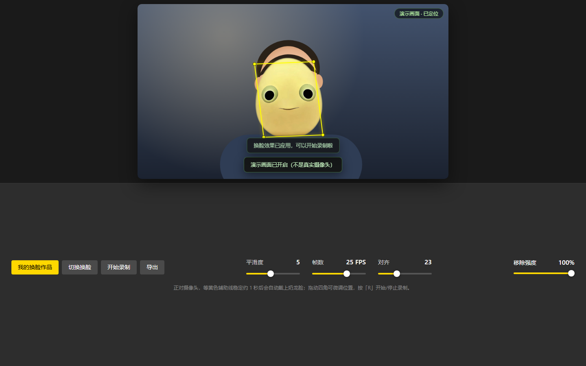

# nailong_play · 奶龙换脸

实时摄像头奶龙换脸 + 视频录制导出的 Web 应用。纯 HTML / CSS / JavaScript，**零依赖、零 CDN、不联网也能跑**；既可以本地开，也可以丢到任意静态托管上变成一个发链接就能玩的小网站。



---

## 快速开始

### 本地运行

双击 `start.bat`，或在本目录执行：

```bat
python -m http.server 8080 --bind 127.0.0.1
```

浏览器打开 <http://127.0.0.1:8080>，首次会请求摄像头授权，点「允许」。

> 必须通过 `http://127.0.0.1` / `http://localhost` 或 HTTPS 访问：浏览器只在安全上下文里允许调用摄像头。直接双击 `index.html`（`file://`）拿不到画面。
>
> 没有摄像头也能体验：错误提示里点「使用演示画面」，或打开 <http://127.0.0.1:8080/?demo=1>（一个会动的示例人像）。

### 线上部署（发给好友）

把整个目录传到任意 HTTPS 静态托管即可（见下文「分享与部署」），例如 GitHub Pages：

```
https://<用户名>.github.io/<仓库名>/nailong_play/
```

---

## 功能一览

| 功能 | 说明 |
| --- | --- |
| 实时摄像头预览 | 上半屏 50%，镜像显示，自动按 16:9 居中 |
| 奶龙换脸 | 奶龙大头贴纸，跟随头部位置 / 大小 / 倾斜角 |
| 黄色四角辅助线 | 自动贴合人脸；四角可拖动微调；稳定约 1 秒后自动应用 |
| 平滑度 | 1–10，控制贴纸边缘羽化 |
| 帧数 | 15–30 FPS，控制渲染与录制帧率 |
| 对齐 | 10–50，控制奶龙头部相对人脸框的大小 |
| 移除强度 | 0–100%，0% 保留原脸，100% 完全换成奶龙 |
| 切换换脸 | 模板面板：内置「奶龙」+ 导入自己的照片 |
| 导入照片 | 自动抠背景 / 裁边 / 对齐眼睛，刷新后仍保留 |
| 录制 | 画布画面 + 摄像头音频，优先 MP4 容器，不支持时回退 WebM |
| 导出 | 一键下载，文件名 `nailong_play_换脸视频_年月日_时分秒.mp4` |
| 我的换脸作品 | 本地保存作品，支持缩略图、下载、删除 |

快捷键：`R` 开始 / 停止录制，`E` 导出，`Esc` 关闭弹层。

### 导入自己的照片

点「切换换脸」→「导入照片」，选一张本地图片（PNG / JPG / WebP）：

1. 透明底或纯色底（白底、绿幕）最好，程序按四角色差自动抠背景；
2. 背景太杂时用椭圆遮罩把人像裁成大头贴兜底；
3. 自动裁掉多余边距、底部做柔和过渡、用一次临时人脸定位对齐眼睛；
4. 卡片右上角 ✕ 删除后恢复内置奶龙；素材存在浏览器 IndexedDB 里，刷新仍在。

---

## 参数怎么调

| 参数 | 默认 | 范围 | 作用 |
| --- | --- | --- | --- |
| 平滑度 | 5 | 1–10 | 边缘羽化半径，越大越柔和 |
| 帧数 | 25 FPS | 15–30 | 渲染与录制帧率，录制中改会在下次生效 |
| 对齐 | 23 | 10–50 | 奶龙头部相对人脸框的大小，偏小露边、偏大盖住头发 |
| 移除强度 | 100% | 0–100% | 贴纸不透明度，即原脸被「移除」的程度 |

定位不准（逆光、侧脸、戴帽子）时直接拖黄色四角；点右上角「恢复自动对位」交还给跟踪。

---

## 录制与导出

- 录制的是**合成后的画面**（摄像头 + 贴纸），不含黄色辅助线，分辨率与摄像头一致（如 1280×720）；
- 容器按浏览器能力自动选择：新版 Chrome / Edge / Safari 直接录 **MP4（H.264）**；否则录 WebM，导出文件如实使用 `.webm` 后缀；
- 作品存在浏览器 **IndexedDB**（数据库名沿用旧名 `niufaces`，改过程序名也不会丢数据）；
- 清除站点数据会一并清除作品和导入的贴纸。

---

## 分享与部署

这是纯静态项目，放到 HTTPS 静态托管上就是一个能直接分享的小网站。

| 平台 | 免费 | 国内访问 | 备注 |
| --- | --- | --- | --- |
| GitHub Pages | ✅ | 一般（时快时慢） | 最省事，仓库公开即可 |
| Cloudflare Pages | ✅ | 一般偏好 | 连 GitHub 自动部署 |
| Vercel / Netlify | ✅ | 一般 | 海外节点 |
| 腾讯云 COS / 阿里云 OSS 静态网站 | 少量费用 | 快 | 需备案域名；OSS 默认域名访问 HTML 会被强制下载 |
| 自有服务器 / 宝塔 | 看情况 | 快 | 记得配 HTTPS 证书 |

### GitHub Pages（最省事）

1. 仓库 `Settings → Pages → Source` 选 `Deploy from a branch`；
2. 分支 `main`，目录 `/ (root)`，Save；
3. 等约 1 分钟，访问 `https://<用户名>.github.io/<仓库名>/nailong_play/`。

本项目在 `nailong_play/` 子目录里，所以地址必须带这一层，否则 404。若想让站点根目录直接是应用（地址不带子目录），把 `nailong_play/` 里的文件移到仓库根即可。

### 分享给好友

- 手机上把链接发微信 / QQ 就能打开，是 H5 页面，不用装东西；
- 浏览器菜单「添加到主屏幕」后像 App 一样全屏打开（已带 `manifest.webmanifest` + 图标）；
- 微信里自定义分享卡片（标题 / 缩略图 / 描述）需要**公众号 + 微信 JS-SDK + 备案域名**，纯静态站做不到；
- 部署后把 `index.html` 里 `og:image` / `twitter:image` 改成绝对地址（`https://你的域名/.../assets/icon-512.png`），QQ / Telegram / Twitter 的卡片才会带图。

### 能不能做成微信小程序？

**不能直接转换**，要按小程序 API 重写一层：

- 界面是 WXML / WXSS，不是 HTML / CSS；Canvas 也要用 `wx.createSelectorQuery` 取节点；
- 摄像头要用 `<camera>` 组件 + `CameraContext.onCameraFrame` 拿逐帧数据，不能用 `getUserMedia`；
- 录制用 `wx.createMediaRecorder`（录 Canvas），保存用 `wx.saveVideoToPhotosAlbum`；
- 还需要小程序 AppID、微信开发者工具、提交审核（个人主体可发布，需实名）。

工作量：贴纸合成、人脸定位、参数联动这些**算法代码能复用约 70%**，但界面、摄像头 / 录制 / 存储要重写，另外补授权引导、相册保存等小程序流程。要做的话建议单独建一个小程序工程，把这几个模块搬过去。

---

## 技术实现

```
index.html          页面结构（预览区 50% + 控制面板 50% + 两个弹层）
style.css           深色主题、按钮 / 滑杆 / 弹层 / 响应式
app.js              摄像头、人脸定位、贴纸合成、录制、存储、导出
manifest.webmanifest / assets/icon-*.png   添加到主屏幕所需的图标
assets/nailong-face.png                   贴纸素材（560×679，透明底）
test/run-tests.mjs  无头 Chrome 自动化验收
```

### 离线人脸定位（无模型文件）

1. 画面缩到 208px 长边，按 RGB + YCbCr + 亮度三重条件分割**肤色区域**（亮度下限排除头发、眉毛）；
2. 四连通域标记，按面积、长宽比、实心度、居中程度（参考上一帧位置）选出最像人脸的一块；
3. 取连通域上部最宽的一行估算脸颊宽度，推算头部方框；
4. 在脸框**内接椭圆**内找一对对称暗块作为眼睛，修正水平位置与倾斜角；
5. 对结果做时序平滑。

跟手程度：每 **60ms** 检测一次（约 16Hz），四角用 0.72 插值追赶，大幅位移直接吸附；人脸丢失超过 1 秒清空历史，重新出现立刻锁定。

### 换脸合成

- 贴纸素材按原生尺寸进缓存（768×768 画布，头部宽 ≈ 素材原宽，眼睛对齐画布中心），只在最终绘制时做一次高质量缩放；
- 平滑度用「alpha 通道高斯模糊 + 相乘」生成羽化边，按模板 + 参数缓存；
- 每帧把贴纸按四角的中心 / 尺寸 / 旋转画到离屏合成画布，录制流也取自这块画布，**预览与成片完全一致**；
- 素材加载失败时退回内置矢量奶龙脸，不会白屏。

### 导入照片的处理

原图缩到 1400px 内 → 有透明通道直接用，否则四角取色判断背景：纯色按色差抠图，太杂用椭圆遮罩 → 取非透明外接框裁切 → 底部 6% 渐隐 → 缩到 560px 宽 → 用一次临时人脸定位估计眼睛高度（失败用 44%）。

### 录制

`canvas.captureStream(fps)` + `MediaRecorder`，摄像头音频轨一并加入；不可用或抛错时给明确提示，不会静默失败。

---

## 自动化验收

```bash
# 先在本目录启动静态服务器（8080）
node test/run-tests.mjs
```

用 CDP 驱动无头 Chrome 跑完整流程，覆盖：换脸是否渲染、定位是否居中/水平、四角拖拽与自动对位、移除强度 0%/100%、**解码回放录制视频确认画面里真有奶龙**、作品库与导出、样式取值、**导入自定义照片（纯色抠图 + 杂乱背景兜底 + 刷新恢复）**、manifest / 图标 / 分享卡片标签、三种窗口尺寸的响应式、摄像头权限被拒兜底。

截图在 `test/shots/`：`00` 贴纸、`01` 换脸效果、`02` 模板面板、`04` 作品库、`05`/`09` 摄像头与权限兜底、`06~08` 三种宽度布局。

> 脚本会启动无头 Chrome，需要允许创建本地进程；受限沙箱里可能跑不起来，换普通终端执行。

---

## 已知限制

- 人脸定位是启发式算法，不是神经网络：强逆光、口罩、大幅侧脸可能偏移，拖四角修正；
- 摄像头只在 `localhost` / HTTPS 下可用；
- 录制编码取决于浏览器，老版本 Chrome 只能录 WebM（可用 ffmpeg 转 MP4）；
- 作品和导入的照片存放在浏览器本地，换设备 / 清数据不会保留；
- 导入照片的抠图是「纯色背景 + 椭圆兜底」，不是语义分割。

---

## 常见问题

**打开黑屏 / 一直「等待摄像头」**
确认用 `http://127.0.0.1:8080` 而不是 `file://`；检查摄像头是否被其他程序占用。

**「未检测到人脸」**
光线太暗或脸太小，让脸占画面 1/4 以上并正面朝光，或直接拖四角手动定位。

**导出的文件是 .webm**
该浏览器不支持 MP4 录制，用 `ffmpeg -i in.webm -c:v libx264 -c:a aac out.mp4` 转码。

**录制没有声音**
首次授权拒绝了麦克风，程序会退化为纯视频；到浏览器权限设置里重新允许后刷新。

**Pages 打开 404**
地址少了 `/nailong_play/`，或部署还没完成（等 1 分钟再 Ctrl+F5）。
